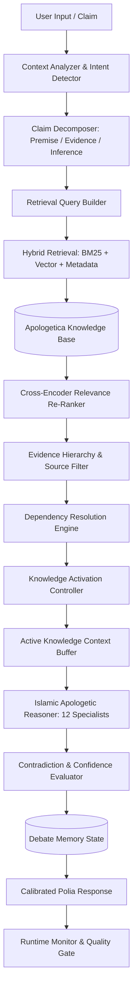

# Future Autonomous Runtime Architecture
## Polia Knowledge-Activated Reasoning Engine

### Component Status Matrix
| Component | Status | Description |
| :--- | :--- | :--- |
| Knowledge Base (150 Steps) | **EXISTING** | 166 files on disk, fully audited |
| Master Index & Governance | **EXISTING** | Fully articulated rules and standards |
| Specialist Architecture (12) | **EXISTING** | Canonical guideline files ready |
| Chief System Prompt | **EXISTING** | 99_AI_SYSTEM_PROMPT.md ready |
| Hybrid Retrieval Pipeline | **PROPOSED** | BM25 + Vector embedding search |
| Claim Decomposer | **PROPOSED** | Propositional breakdown engine |
| Knowledge Activation Controller | **PROPOSED** | Context token budgeter & injector |
| Debate State Memory | **PROPOSED** | Multi-turn debate continuity tracker |
| Runtime Monitor | **PROPOSED** | Verification & anti-hallucination guard |
