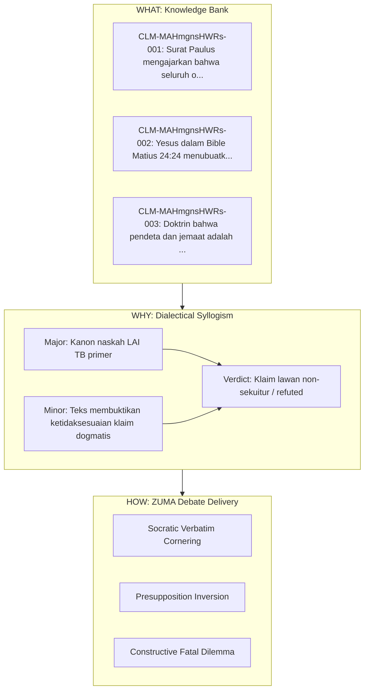

# Argument Map: Doktrin Tubuh Kristus (1 Korintus 12 / Efesus 5) vs Nubuatan Kristus Palsu (Matius 24)
**Video ID**: `MAHmgnsHWRs` | **Persona Profile**: `zuma_debate_v1`

## 1. Dialectical Topography

## 2. Argument Breakdown & Persona Interventions
### Move 1: Stepwise Definition Funnel
- **Speaker**: `ZUMA` ([SIMULATED ZUMA RESPONSE])
- **Strategy**: `stepwise_definition_funnel`
- **Corpus Provenance**: Video `MAHmgnsHWRs` @ `02:47`
- **Knowledge Target**: `KNOW-REC-CLM-MAHmgnsHWRs-001`
- **Target Scripture**: `1 Korintus 12:27`

### Move 2: Reductio Ad Absurdum
- **Speaker**: `ZUMA` ([SIMULATED ZUMA RESPONSE])
- **Strategy**: `reductio_ad_absurdum`
- **Corpus Provenance**: Video `MAHmgnsHWRs` @ `07:14`
- **Knowledge Target**: `KNOW-REC-CLM-MAHmgnsHWRs-002`
- **Target Scripture**: `1 Korintus 12:27`

### Move 3: Data Focus Interruption
- **Speaker**: `ZUMA` ([SIMULATED ZUMA RESPONSE])
- **Strategy**: `data_focus_interruption`
- **Corpus Provenance**: Video `MAHmgnsHWRs` @ `12:55`
- **Knowledge Target**: `KNOW-REC-CLM-MAHmgnsHWRs-005`
- **Target Scripture**: `1 Korintus 12:27`

### Move 4: Verbatim Textual Challenge
- **Speaker**: `ZUMA` ([SIMULATED ZUMA RESPONSE])
- **Strategy**: `verbatim_textual_challenge`
- **Corpus Provenance**: Video `MAHmgnsHWRs` @ `10:49`
- **Knowledge Target**: `KNOW-REC-CLM-MAHmgnsHWRs-002`
- **Target Scripture**: `1 Korintus 12:27`

### Move 5: Constructive Fatal Dilemma
- **Speaker**: `ZUMA` ([SIMULATED ZUMA RESPONSE])
- **Strategy**: `constructive_fatal_dilemma`
- **Corpus Provenance**: Video `MAHmgnsHWRs` @ `12:23`
- **Knowledge Target**: `KNOW-REC-CLM-MAHmgnsHWRs-003`
- **Target Scripture**: `1 Korintus 12:27`

### Move 6: Presupposition Inversion
- **Speaker**: `ZUMA` ([SIMULATED ZUMA RESPONSE])
- **Strategy**: `presupposition_inversion`
- **Corpus Provenance**: Video `tm7Q1ZoWiS8` @ `08:35`
- **Knowledge Target**: `KNOW-REC-CLM-MAHmgnsHWRs-001`
- **Target Scripture**: `1 Korintus 12:27`

### Move 7: Socratic Verbatim Cornering
- **Speaker**: `ZUMA` ([SIMULATED ZUMA RESPONSE])
- **Strategy**: `socratic_verbatim_cornering`
- **Corpus Provenance**: Video `MUesrqdzI90` @ `19:53`
- **Knowledge Target**: `KNOW-REC-CLM-MAHmgnsHWRs-005`
- **Target Scripture**: `1 Korintus 12:27`

### Move 8: Maieutic Epistemic Verdict
- **Speaker**: `ZUMA` ([SIMULATED ZUMA RESPONSE])
- **Strategy**: `maieutic_epistemic_verdict`
- **Corpus Provenance**: Video `hJci2BInAvQ` @ `2:34:26`
- **Knowledge Target**: `KNOW-REC-CLM-MAHmgnsHWRs-002`
- **Target Scripture**: `1 Korintus 12:27`
