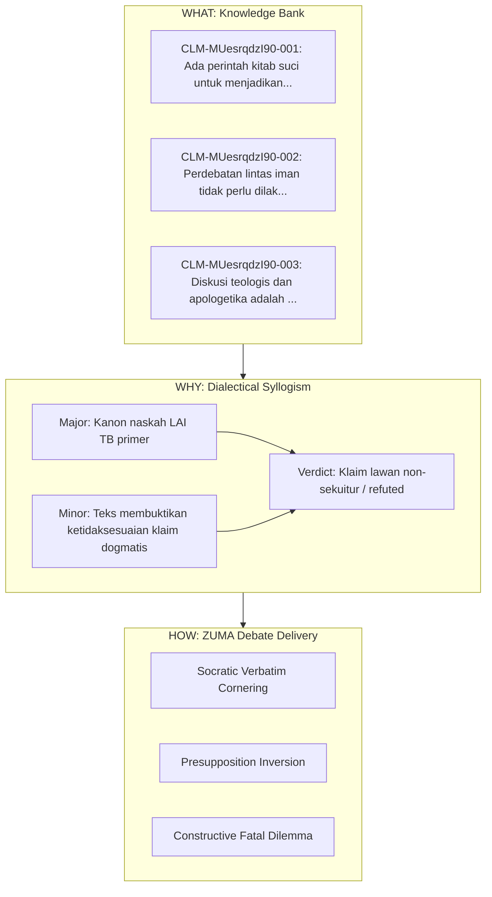

# Argument Map: Urgensi Dialog Iman & Friksi Apostolik Paulus vs Petrus (Galatia 2 & Roma 15)
**Video ID**: `MUesrqdzI90` | **Persona Profile**: `zuma_debate_v1`

## 1. Dialectical Topography

## 2. Argument Breakdown & Persona Interventions
### Move 1: Verbatim Textual Anchoring
- **Speaker**: `ZUMA` ([SIMULATED ZUMA RESPONSE])
- **Strategy**: `verbatim_textual_anchoring`
- **Corpus Provenance**: Video `MUesrqdzI90` @ `19:53`
- **Knowledge Target**: `KNOW-REC-CLM-MUesrqdzI90-003`
- **Target Scripture**: `Matius 28:19`

### Move 2: The Pauline Wedge
- **Speaker**: `ZUMA` ([SIMULATED ZUMA RESPONSE])
- **Strategy**: `the_pauline_wedge`
- **Corpus Provenance**: Video `MUesrqdzI90` @ `20:25`
- **Knowledge Target**: `KNOW-REC-CLM-MUesrqdzI90-005`
- **Target Scripture**: `Matius 28:19`

### Move 3: Extraneous Authority Demolition
- **Speaker**: `ZUMA` ([SIMULATED ZUMA RESPONSE])
- **Strategy**: `extraneous_authority_demolition`
- **Corpus Provenance**: Video `MUesrqdzI90` @ `22:15`
- **Knowledge Target**: `KNOW-REC-CLM-MUesrqdzI90-007`
- **Target Scripture**: `Matius 28:19`

### Move 4: Socratic Verbatim Cornering
- **Speaker**: `ZUMA` ([SIMULATED ZUMA RESPONSE])
- **Strategy**: `socratic_verbatim_cornering`
- **Corpus Provenance**: Video `MUesrqdzI90` @ `19:53`
- **Knowledge Target**: `KNOW-REC-CLM-MUesrqdzI90-005`
- **Target Scripture**: `Matius 28:19`

### Move 5: Constructive Fatal Dilemma
- **Speaker**: `ZUMA` ([SIMULATED ZUMA RESPONSE])
- **Strategy**: `constructive_fatal_dilemma`
- **Corpus Provenance**: Video `MUesrqdzI90` @ `20:25`
- **Knowledge Target**: `KNOW-REC-CLM-MUesrqdzI90-005`
- **Target Scripture**: `Matius 28:19`

### Move 6: Presupposition Inversion
- **Speaker**: `ZUMA` ([SIMULATED ZUMA RESPONSE])
- **Strategy**: `presupposition_inversion`
- **Corpus Provenance**: Video `tm7Q1ZoWiS8` @ `08:35`
- **Knowledge Target**: `KNOW-REC-CLM-MUesrqdzI90-006`
- **Target Scripture**: `Matius 28:19`

### Move 7: Canonical Exclusivity Restriction
- **Speaker**: `ZUMA` ([SIMULATED ZUMA RESPONSE])
- **Strategy**: `canonical_exclusivity_restriction`
- **Corpus Provenance**: Video `MAHmgnsHWRs` @ `10:49`
- **Knowledge Target**: `KNOW-REC-CLM-MUesrqdzI90-003`
- **Target Scripture**: `Matius 28:19`

### Move 8: Maieutic Epistemic Verdict
- **Speaker**: `ZUMA` ([SIMULATED ZUMA RESPONSE])
- **Strategy**: `maieutic_epistemic_verdict`
- **Corpus Provenance**: Video `hJci2BInAvQ` @ `2:34:26`
- **Knowledge Target**: `KNOW-REC-CLM-MUesrqdzI90-005`
- **Target Scripture**: `Matius 28:19`
