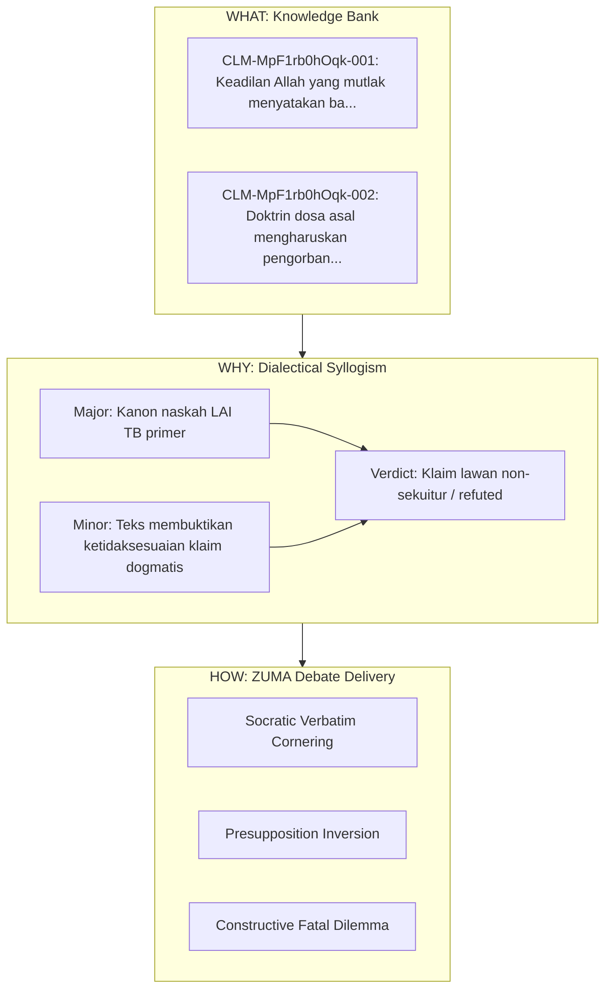

# Argument Map: Keadilan Ilahi vs Doktrin Dosa Waris & Penyaliban Penebusan (Yehezkiel 18:20)
**Video ID**: `MpF1rb0hOqk` | **Persona Profile**: `zuma_debate_v1`

## 1. Dialectical Topography

## 2. Argument Breakdown & Persona Interventions
### Move 1: Verbatim Textual Anchoring
- **Speaker**: `ZUMA` ([SIMULATED ZUMA RESPONSE])
- **Strategy**: `verbatim_textual_anchoring`
- **Corpus Provenance**: Video `MpF1rb0hOqk` @ `11:20`
- **Knowledge Target**: `KNOW-REC-CLM-MpF1rb0hOqk-001`
- **Target Scripture**: `Yehezkiel 18:20 & Ulangan 24:16`

### Move 2: Immanent Dialectical Critique
- **Speaker**: `ZUMA` ([SIMULATED ZUMA RESPONSE])
- **Strategy**: `immanent_dialectical_critique`
- **Corpus Provenance**: Video `MpF1rb0hOqk` @ `11:20`
- **Knowledge Target**: `KNOW-REC-CLM-MpF1rb0hOqk-001`
- **Target Scripture**: `Yehezkiel 18:20 & Ulangan 24:16`

### Move 3: Data Focus Interruption
- **Speaker**: `ZUMA` ([SIMULATED ZUMA RESPONSE])
- **Strategy**: `data_focus_interruption`
- **Corpus Provenance**: Video `MpF1rb0hOqk` @ `11:20`
- **Knowledge Target**: `KNOW-REC-CLM-MpF1rb0hOqk-001`
- **Target Scripture**: `Yehezkiel 18:20 & Ulangan 24:16`

### Move 4: Socratic Verbatim Cornering
- **Speaker**: `ZUMA` ([SIMULATED ZUMA RESPONSE])
- **Strategy**: `socratic_verbatim_cornering`
- **Corpus Provenance**: Video `MpF1rb0hOqk` @ `11:20`
- **Knowledge Target**: `KNOW-REC-CLM-MpF1rb0hOqk-001`
- **Target Scripture**: `Yehezkiel 18:20 & Ulangan 24:16`

### Move 5: Constructive Fatal Dilemma
- **Speaker**: `ZUMA` ([SIMULATED ZUMA RESPONSE])
- **Strategy**: `constructive_fatal_dilemma`
- **Corpus Provenance**: Video `MpF1rb0hOqk` @ `11:20`
- **Knowledge Target**: `KNOW-REC-CLM-MpF1rb0hOqk-001`
- **Target Scripture**: `Yehezkiel 18:20 & Ulangan 24:16`

### Move 6: Presupposition Inversion
- **Speaker**: `ZUMA` ([SIMULATED ZUMA RESPONSE])
- **Strategy**: `presupposition_inversion`
- **Corpus Provenance**: Video `MpF1rb0hOqk` @ `11:20`
- **Knowledge Target**: `KNOW-REC-CLM-MpF1rb0hOqk-001`
- **Target Scripture**: `Yehezkiel 18:20 & Ulangan 24:16`

### Move 7: Canonical Exclusivity Restriction
- **Speaker**: `ZUMA` ([SIMULATED ZUMA RESPONSE])
- **Strategy**: `canonical_exclusivity_restriction`
- **Corpus Provenance**: Video `MpF1rb0hOqk` @ `11:20`
- **Knowledge Target**: `KNOW-REC-CLM-MpF1rb0hOqk-001`
- **Target Scripture**: `Yehezkiel 18:20 & Ulangan 24:16`

### Move 8: Maieutic Epistemic Verdict
- **Speaker**: `ZUMA` ([SIMULATED ZUMA RESPONSE])
- **Strategy**: `maieutic_epistemic_verdict`
- **Corpus Provenance**: Video `MpF1rb0hOqk` @ `11:20`
- **Knowledge Target**: `KNOW-REC-CLM-MpF1rb0hOqk-001`
- **Target Scripture**: `Yehezkiel 18:20 & Ulangan 24:16`
