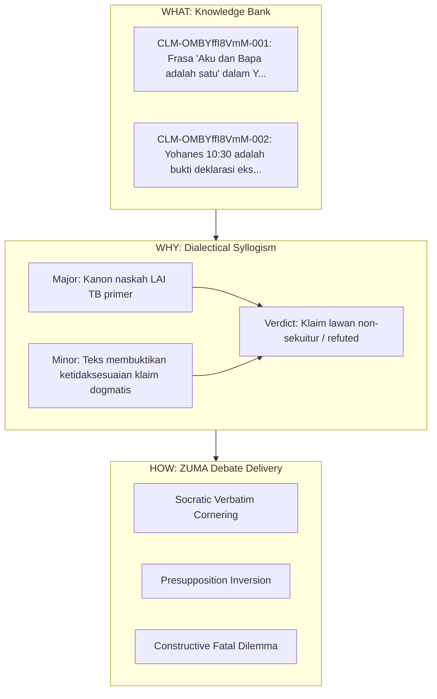

# Argument Map: Integritas Eksegesis: Cherry-Picking Ayat vs Konteks Narasi Utuh (Yohanes 10:30 vs Yohanes 17)
**Video ID**: `OMBYffI8VmM` | **Persona Profile**: `zuma_debate_v1`

## 1. Dialectical Topography

## 2. Argument Breakdown & Persona Interventions
### Move 1: Verbatim Textual Anchoring
- **Speaker**: `ZUMA` ([SIMULATED ZUMA RESPONSE])
- **Strategy**: `verbatim_textual_anchoring`
- **Corpus Provenance**: Video `OMBYffI8VmM` @ `26:49`
- **Knowledge Target**: `KNOW-REC-CLM-OMBYffI8VmM-001`
- **Target Scripture**: `Yohanes 10:30 & Yohanes 17:21-22`

### Move 2: Context Expansion Rebuttal
- **Speaker**: `ZUMA` ([SIMULATED ZUMA RESPONSE])
- **Strategy**: `context_expansion_rebuttal`
- **Corpus Provenance**: Video `OMBYffI8VmM` @ `26:49`
- **Knowledge Target**: `KNOW-REC-CLM-OMBYffI8VmM-001`
- **Target Scripture**: `Yohanes 10:30 & Yohanes 17:21-22`

### Move 3: Data Focus Interruption
- **Speaker**: `ZUMA` ([SIMULATED ZUMA RESPONSE])
- **Strategy**: `data_focus_interruption`
- **Corpus Provenance**: Video `OMBYffI8VmM` @ `26:49`
- **Knowledge Target**: `KNOW-REC-CLM-OMBYffI8VmM-001`
- **Target Scripture**: `Yohanes 10:30 & Yohanes 17:21-22`

### Move 4: Context Expansion Rebuttal
- **Speaker**: `ZUMA` ([SIMULATED ZUMA RESPONSE])
- **Strategy**: `context_expansion_rebuttal`
- **Corpus Provenance**: Video `OMBYffI8VmM` @ `26:49`
- **Knowledge Target**: `KNOW-REC-CLM-OMBYffI8VmM-001`
- **Target Scripture**: `Yohanes 10:30 & Yohanes 17:21-22`

### Move 5: Constructive Fatal Dilemma
- **Speaker**: `ZUMA` ([SIMULATED ZUMA RESPONSE])
- **Strategy**: `constructive_fatal_dilemma`
- **Corpus Provenance**: Video `OMBYffI8VmM` @ `26:49`
- **Knowledge Target**: `KNOW-REC-CLM-OMBYffI8VmM-001`
- **Target Scripture**: `Yohanes 10:30 & Yohanes 17:21-22`

### Move 6: Presupposition Inversion
- **Speaker**: `ZUMA` ([SIMULATED ZUMA RESPONSE])
- **Strategy**: `presupposition_inversion`
- **Corpus Provenance**: Video `OMBYffI8VmM` @ `26:49`
- **Knowledge Target**: `KNOW-REC-CLM-OMBYffI8VmM-001`
- **Target Scripture**: `Yohanes 10:30 & Yohanes 17:21-22`

### Move 7: Canonical Exclusivity Restriction
- **Speaker**: `ZUMA` ([SIMULATED ZUMA RESPONSE])
- **Strategy**: `canonical_exclusivity_restriction`
- **Corpus Provenance**: Video `OMBYffI8VmM` @ `26:49`
- **Knowledge Target**: `KNOW-REC-CLM-OMBYffI8VmM-001`
- **Target Scripture**: `Yohanes 10:30 & Yohanes 17:21-22`

### Move 8: Maieutic Epistemic Verdict
- **Speaker**: `ZUMA` ([SIMULATED ZUMA RESPONSE])
- **Strategy**: `maieutic_epistemic_verdict`
- **Corpus Provenance**: Video `OMBYffI8VmM` @ `26:49`
- **Knowledge Target**: `KNOW-REC-CLM-OMBYffI8VmM-001`
- **Target Scripture**: `Yohanes 10:30 & Yohanes 17:21-22`
