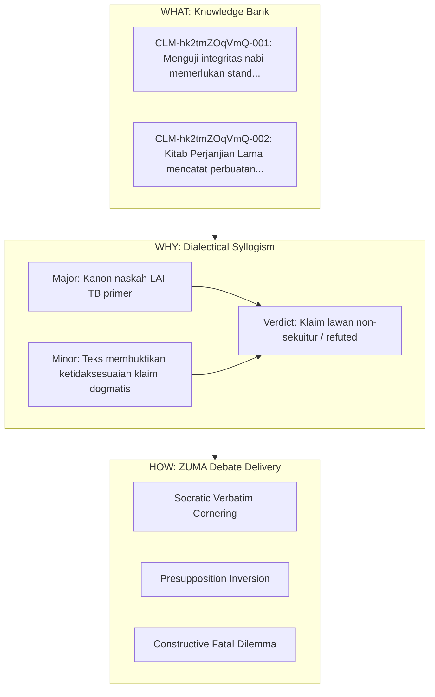

# Argument Map: Standar Moralitas Kenabian: Serangan Hadis vs Catatan Moral Tokoh Bible
**Video ID**: `hk2tmZOqVmQ` | **Persona Profile**: `zuma_debate_v1`

## 1. Dialectical Topography

## 2. Argument Breakdown & Persona Interventions
### Move 1: Verbatim Textual Anchoring
- **Speaker**: `ZUMA` ([SIMULATED ZUMA RESPONSE])
- **Strategy**: `verbatim_textual_anchoring`
- **Corpus Provenance**: Video `hk2tmZOqVmQ` @ `6:45`
- **Knowledge Target**: `KNOW-REC-CLM-hk2tmZOqVmQ-001`
- **Target Scripture**: `Kejadian 19:30-38 & 2 Samuel 11:1-27`

### Move 2: Tu Quoque Demolition
- **Speaker**: `ZUMA` ([SIMULATED ZUMA RESPONSE])
- **Strategy**: `tu_quoque_demolition`
- **Corpus Provenance**: Video `hk2tmZOqVmQ` @ `06:45`
- **Knowledge Target**: `KNOW-REC-CLM-hk2tmZOqVmQ-001`
- **Target Scripture**: `Kejadian 19:30-38 & 2 Samuel 11:1-27`

### Move 3: Data Focus Interruption
- **Speaker**: `ZUMA` ([SIMULATED ZUMA RESPONSE])
- **Strategy**: `data_focus_interruption`
- **Corpus Provenance**: Video `hk2tmZOqVmQ` @ `6:45`
- **Knowledge Target**: `KNOW-REC-CLM-hk2tmZOqVmQ-001`
- **Target Scripture**: `Kejadian 19:30-38 & 2 Samuel 11:1-27`

### Move 4: Socratic Verbatim Cornering
- **Speaker**: `ZUMA` ([SIMULATED ZUMA RESPONSE])
- **Strategy**: `socratic_verbatim_cornering`
- **Corpus Provenance**: Video `hk2tmZOqVmQ` @ `6:45`
- **Knowledge Target**: `KNOW-REC-CLM-hk2tmZOqVmQ-001`
- **Target Scripture**: `Kejadian 19:30-38 & 2 Samuel 11:1-27`

### Move 5: Constructive Fatal Dilemma
- **Speaker**: `ZUMA` ([SIMULATED ZUMA RESPONSE])
- **Strategy**: `constructive_fatal_dilemma`
- **Corpus Provenance**: Video `hk2tmZOqVmQ` @ `6:45`
- **Knowledge Target**: `KNOW-REC-CLM-hk2tmZOqVmQ-001`
- **Target Scripture**: `Kejadian 19:30-38 & 2 Samuel 11:1-27`

### Move 6: Presupposition Inversion
- **Speaker**: `ZUMA` ([SIMULATED ZUMA RESPONSE])
- **Strategy**: `presupposition_inversion`
- **Corpus Provenance**: Video `hk2tmZOqVmQ` @ `6:45`
- **Knowledge Target**: `KNOW-REC-CLM-hk2tmZOqVmQ-001`
- **Target Scripture**: `Kejadian 19:30-38 & 2 Samuel 11:1-27`

### Move 7: Canonical Exclusivity Restriction
- **Speaker**: `ZUMA` ([SIMULATED ZUMA RESPONSE])
- **Strategy**: `canonical_exclusivity_restriction`
- **Corpus Provenance**: Video `hk2tmZOqVmQ` @ `6:45`
- **Knowledge Target**: `KNOW-REC-CLM-hk2tmZOqVmQ-001`
- **Target Scripture**: `Kejadian 19:30-38 & 2 Samuel 11:1-27`

### Move 8: Maieutic Epistemic Verdict
- **Speaker**: `ZUMA` ([SIMULATED ZUMA RESPONSE])
- **Strategy**: `maieutic_epistemic_verdict`
- **Corpus Provenance**: Video `hk2tmZOqVmQ` @ `6:45`
- **Knowledge Target**: `KNOW-REC-CLM-hk2tmZOqVmQ-001`
- **Target Scripture**: `Kejadian 19:30-38 & 2 Samuel 11:1-27`
