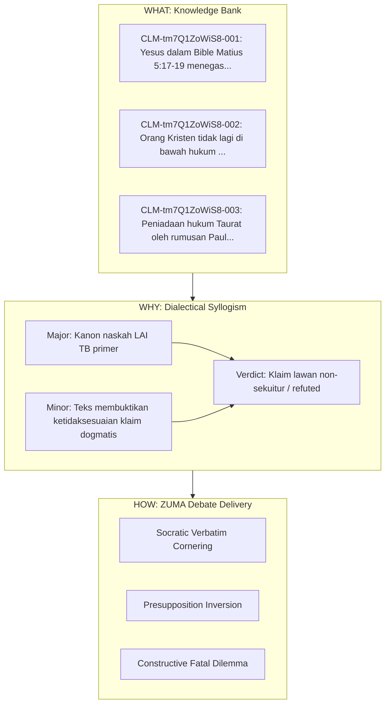

# Argument Map: Hukum Taurat Kekal vs Peniadaan Hukum oleh Paulus (Matius 5:17 vs Galatia 3:13)
**Video ID**: `tm7Q1ZoWiS8` | **Persona Profile**: `zuma_debate_v1`

## 1. Dialectical Topography

## 2. Argument Breakdown & Persona Interventions
### Move 1: Verbatim Textual Anchoring
- **Speaker**: `ZUMA` ([SIMULATED ZUMA RESPONSE])
- **Strategy**: `verbatim_textual_anchoring`
- **Corpus Provenance**: Video `tm7Q1ZoWiS8` @ `8:35`
- **Knowledge Target**: `KNOW-REC-CLM-tm7Q1ZoWiS8-001`
- **Target Scripture**: `Matius 5:17-19`

### Move 2: The Pauline Wedge
- **Speaker**: `ZUMA` ([SIMULATED ZUMA RESPONSE])
- **Strategy**: `the_pauline_wedge`
- **Corpus Provenance**: Video `tm7Q1ZoWiS8` @ `09:40`
- **Knowledge Target**: `KNOW-REC-CLM-tm7Q1ZoWiS8-001`
- **Target Scripture**: `Matius 5:17-19`

### Move 3: Data Focus Interruption
- **Speaker**: `ZUMA` ([SIMULATED ZUMA RESPONSE])
- **Strategy**: `data_focus_interruption`
- **Corpus Provenance**: Video `tm7Q1ZoWiS8` @ `8:35`
- **Knowledge Target**: `KNOW-REC-CLM-tm7Q1ZoWiS8-001`
- **Target Scripture**: `Matius 5:17-19`

### Move 4: Socratic Verbatim Cornering
- **Speaker**: `ZUMA` ([SIMULATED ZUMA RESPONSE])
- **Strategy**: `socratic_verbatim_cornering`
- **Corpus Provenance**: Video `tm7Q1ZoWiS8` @ `8:35`
- **Knowledge Target**: `KNOW-REC-CLM-tm7Q1ZoWiS8-001`
- **Target Scripture**: `Matius 5:17-19`

### Move 5: Constructive Fatal Dilemma
- **Speaker**: `ZUMA` ([SIMULATED ZUMA RESPONSE])
- **Strategy**: `constructive_fatal_dilemma`
- **Corpus Provenance**: Video `tm7Q1ZoWiS8` @ `8:35`
- **Knowledge Target**: `KNOW-REC-CLM-tm7Q1ZoWiS8-001`
- **Target Scripture**: `Matius 5:17-19`

### Move 6: Presupposition Inversion
- **Speaker**: `ZUMA` ([SIMULATED ZUMA RESPONSE])
- **Strategy**: `presupposition_inversion`
- **Corpus Provenance**: Video `tm7Q1ZoWiS8` @ `8:35`
- **Knowledge Target**: `KNOW-REC-CLM-tm7Q1ZoWiS8-001`
- **Target Scripture**: `Matius 5:17-19`

### Move 7: Canonical Exclusivity Restriction
- **Speaker**: `ZUMA` ([SIMULATED ZUMA RESPONSE])
- **Strategy**: `canonical_exclusivity_restriction`
- **Corpus Provenance**: Video `tm7Q1ZoWiS8` @ `8:35`
- **Knowledge Target**: `KNOW-REC-CLM-tm7Q1ZoWiS8-001`
- **Target Scripture**: `Matius 5:17-19`

### Move 8: Maieutic Epistemic Verdict
- **Speaker**: `ZUMA` ([SIMULATED ZUMA RESPONSE])
- **Strategy**: `maieutic_epistemic_verdict`
- **Corpus Provenance**: Video `tm7Q1ZoWiS8` @ `8:35`
- **Knowledge Target**: `KNOW-REC-CLM-tm7Q1ZoWiS8-001`
- **Target Scripture**: `Matius 5:17-19`
