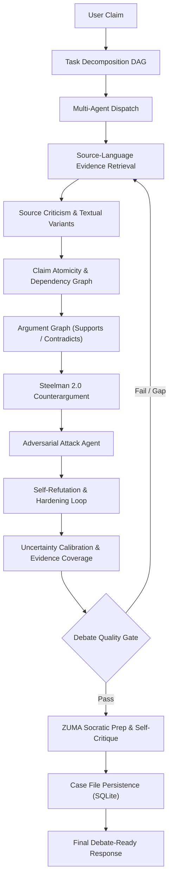

# Polya Epistemic Quality, Adversarial Research & Apologetics Intelligence Engine

## 1. Overview
Master Prompt #3 elevates Polya from an autonomous research engine into a self-critical, evidence-grounded, adversarial debate intelligence. Central principle: **Polya must attack its own provisional conclusion before presenting that conclusion to the user.**

---

## 2. Core Epistemic Components

### 2.1 Epistemic Firewall (`orchestrator/epistemic_firewall.py`)
Enforces strict epistemic tiers:
- `DIRECTLY_VERIFIED` (Requires primary text witness)
- `STRONGLY_SUPPORTED`
- `SUPPORTED`
- `PARTIALLY_SUPPORTED`
- `INFERRED` (Blocked from silently mutating to DIRECTLY_VERIFIED)
- `INTERPRETIVE`
- `DISPUTED` (Blocked from silently mutating to VERIFIED)
- `UNSUPPORTED`
- `UNKNOWN`

### 2.2 Claim Atomicity & Dependency Graph (`orchestrator/claim_atomicity.py`)
Breaks complex theological claims into atomic propositions (A–G).
- Tracks relations: `supports`, `contradicts`, `depends_on`, `qualifies`, `limits`, `contextualizes`.
- If an essential premise (e.g., Premise C or D) is refuted or unsupported, the downstream conclusion is marked as invalid (`PREMISE_FAILURE_DETECTED`), preventing false certainty inheritance.

### 2.3 Source & Textual Criticism Engine (`orchestrator/source_criticism.py`)
- Evaluates primary texts, manuscript witnesses, critical editions (NA28 / UBS5 / BHS).
- **Textual Criticism Firewall**: Audits variants across Codex Sinaiticus, Codex Vaticanus, Codex Alexandrinus, and early papyri (P46, P66, P75).
- **Translation Audit**: Exposes translation distortions and semantic erasure in vernacular translations (LAI TB, KJV).
- **Philological Adversarial Test**: Stress-tests lexical claims using BDAG, HALOT, and syntax parsing; classifies lemmas as `LEXICALLY_STRONG`, `LEXICALLY_PLAUSIBLE`, `LEXICALLY_WEAK`, or `LEXICALLY_UNSUPPORTED`.
- **Context Firewall**: Prevents verse isolation by requiring immediate pericope, chapter discourse, historical setting, genre, and rhetorical intent.

### 2.4 Adversarial Engine & Self-Refutation (`orchestrator/adversarial_engine.py`)
- **Steelman 2.0 & AdversarialDebateAgent**: Formulates the strongest opposing counterarguments using opposing proof-texts (e.g., Galatia 3:24-25, Roma 10:4).
- **Self-Refutation Loop**: Tests if provisional conclusions withstand hostile cross-examination; refines arguments to eliminate overreach.
- **Citation Overreach Detector**: Classifies quotes into `DIRECTLY_SUPPORTED`, `REASONABLE_INFERENCE`, or `UNSUPPORTED_EXTENSION`.
- **Fallacy Detection Engine**: Scans for 13 reasoning fallacies (Strawman, False Dilemma, Begging the Question, Equivocation, Category Error, Quote Mining, etc.).
- **ZUMA Self-Critique**: Exposes Polya's own weakest premise, easiest sentence to refute, and provides hardening recommendations before delivery.
- **Debate Quality Gate**: Ensures all criteria are met before user presentation.

---

## 3. Case File Storage & Reproducibility
Extended `CanonicalCaseFile` schema in SQLite (`data/polya_arena.db` / `case_files_v2`):
- `epistemic_audit`
- `adversarial_attacks`
- `source_criticism`
- `translation_audit`
- `citation_audit`
- `fallacy_audit`
- `uncertainty`
- `evidence_coverage`
- `argument_strength`
- `weakest_point`
