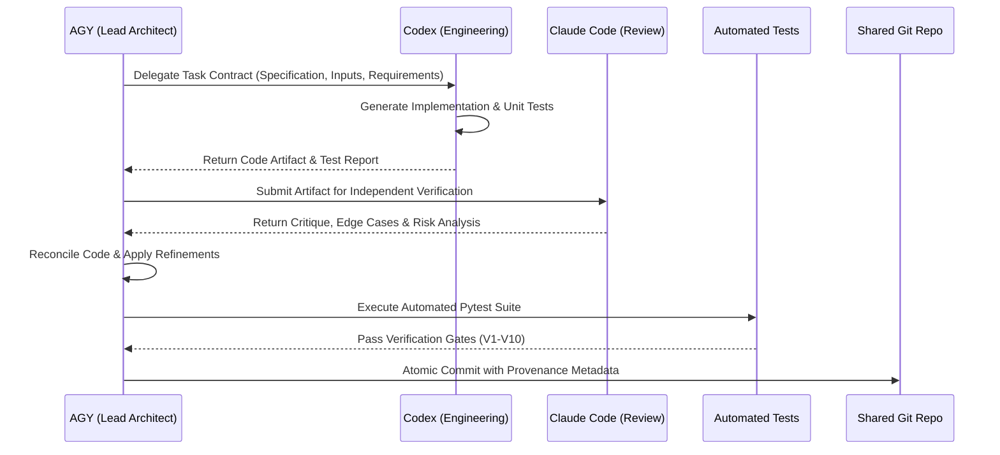

# AGENT ORCHESTRATION SPECIFICATION: POLYA PHILOLOGICAL BIBLE ENGINE
**Contract Reference**: Architecture v2.0 — FROZEN  
**Multi-Agent Environment**: VPS Linux (`ip-172-31-16-239`)  
**Participating Agents**: AGY, Hermes, Codex, Claude Code  
**Document Owner**: AGY  
**Date**: 2026-09-30  

---

## 1. Agent Roles, Capabilities, and Boundaries

### 1.1 AGY (Antigravity CLI Agent)
- **Role**: Lead Architect, Primary Implementer, Integrator, Documentation Owner.
- **Capabilities**:
  - Full codebase inspection, file manipulation, and terminal execution within `/home/ubuntu`.
  - Native MCP tool caller and subagent coordinator.
  - Final authority over architecture compliance, pull requests, and Git commits.
- **Limitations**:
  - Must not blindly validate its own high-risk outputs without independent review.
  - Must not fabricate or alter primary source texts.

### 1.2 Hermes (Orchestration & Gateway Layer)
- **Role**: Workflow Orchestration, Background Jobs, Workgraphs, Checkpointing, and Retries.
- **Capabilities**:
  - Active background daemon (PID 595437) and MCP server (PID 718705).
  - Messaging gateway (Mattermost, WhatsApp, A2A, etc.).
  - Background task scheduling and execution tracking.
- **Integration Mechanism**:
  - Direct CLI invocation (`hermes task run`, `hermes job queue`).
  - MCP tool interface (`call_mcp_tool` on `hermes` and `hermes-tools` servers).
- **Limitations**:
  - Does not independently author philological parsing logic; coordinates workers.

### 1.3 Codex (Engineering & Refactoring Worker)
- **Role**: Independent Engineering Worker, Parser Implementer, Unit Test Generator.
- **Capabilities**:
  - Local daemon active on PID 470005 and 698024.
  - Non-interactive CLI invocation via `codex exec "<task>"` and `codex review`.
- **Integration Mechanism**:
  - Subprocess execution via `run_command` in headless batch mode:
    ```bash
    codex exec --sandbox workspace-write "implement unit tests for Greek morphology guards in tests/test_greek_guards.py"
    ```
- **Limitations**:
  - Output is treated as proposed code or evidence; requires AGY review and test validation before commit.

### 1.4 Claude Code (Review & Critique Worker)
- **Role**: Independent Code Reviewer, Architecture Critic, Safety & Anti-Hallucination Auditor.
- **Capabilities**:
  - Available as `claude` CLI v2.1.283.
  - Non-interactive batch execution via `claude -p "<prompt>"` or JSON agent specs.
- **Integration Mechanism**:
  - Subprocess execution via `run_command`:
    ```bash
    claude -p "Review the attached schema for SQL injection, missing foreign keys, and source provenance compliance" < schema.sql
    ```
- **Limitations**:
  - Read-only review unless explicitly delegated with write flags; does not directly commit to Git.

---

## 2. Multi-Agent Workflows & Coordination Patterns

### 2.1 Low-Risk Workflow (AGY Independent)
For simple documentation, minor test tweaks, or routine updates:
$$\text{AGY} \longrightarrow \text{TEST} \longrightarrow \text{GIT COMMIT}$$

### 2.2 High-Risk Implementation Workflow
For database schemas, core parsers, textual criticism, identity firewalls, or security:
$$\text{AGY (Design)} \longrightarrow \text{CODEX (Implement/Test)} \longrightarrow \text{CLAUDE CODE (Review)} \longrightarrow \text{TEST SUITE} \longrightarrow \text{AGY (Integration & Commit)}$$



---

## 3. Disagreement Adjudication Protocol
When agents disagree (e.g. Codex proposes Architecture A while Claude Code flags a regression risk):
1. **No Majority Voting**: Consensus is rejected as an epistemic truth mechanism.
2. **Evidence Comparison**:
   - Compare claim, source text, grammatical citation, and test results.
3. **Targeted Benchmarking**:
   - Run a deterministic test case (e.g. on the Golden Corpus) to resolve ambiguity.
4. **Adjudication**:
   - AGY makes the final architectural determination based on highest-level evidence.
   - If unresolved, mark the item as `NEEDS_REVIEW` and preserve both alternatives.

---

## 4. Artifact & State Management
- All communication across agents is mediated through versioned disk artifacts:
  - Task specifications in `docs/bible_engine/tasks/`
  - Code patches via Git commits and diffs
  - Test reports in `.pytest_cache` and test output logs
  - Audit logs in `/home/ubuntu/.polya/`
