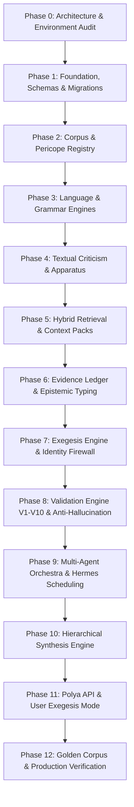

# IMPLEMENTATION PLAN: POLYA PHILOLOGICAL BIBLE ENGINE
**Version**: Architecture v2.0 — FROZEN  
**Target Repository**: `/home/ubuntu/Polya-AI`  
**Execution Authority**: AGY (Lead Architect & Primary Implementer)  
**Date**: 2026-09-30  

---

## 1. Overview & Phased Roadmap

---

## 2. Phase-by-Phase Detailed Specifications

### Phase 1: Foundation, Schemas, Database, & Migrations
- **Objective**: Establish SQLite (development) and PostgreSQL-ready relational schemas with cryptographic provenance.
- **Components**:
  - `schemas/bible_engine/001_initial_schema.sql`: Tables for `sources`, `witnesses`, `editions`, `books`, `pericopes`, `tokens`, `claims`, `evidence_ledger`.
  - `provenance.py`: SHA-256 source hashing, version tracking, and audit log models.
- **Agent Delegation**: AGY (Design & Implementation), Codex (Review & Migration script validation).

### Phase 2: Corpus Ingestion & Pericope Registry
- **Objective**: Canonical boundary registry for Genesis through Revelation.
- **Components**:
  - Ingestion modules for critical Greek (NA28 / SBLGNT format), Hebrew (Masoretic / Leningradensis format), and Aramaic portions.
  - Pericope boundary definitions with boundary confidence ratings.
- **Agent Delegation**: AGY (Ingestion parser), Claude Code (Boundary review & integrity check).

### Phase 3: Language Engines (Greek, Hebrew, Aramaic)
- **Objective**: Token-level morphology, lemma extraction, and grammatical guards.
- **Components**:
  - Lexical parsing pipelines for Greek, Hebrew, Aramaic.
  - Grammatical guards preventing automatic theological projections from verbal aspects or grammatical gender.
- **Agent Delegation**: Codex (Parsing routines & guards implementation), AGY (Architecture integration).

### Phase 4: Textual Criticism Engine
- **Objective**: Apparatus management, variant units, primary witness tracking (א, B, DSS, MT, LXX).
- **Components**:
  - Variant unit model separating external evidence from internal scribal tendencies.
  - Textual confidence calibration metrics.
- **Agent Delegation**: AGY (Core engine), Claude Code (Textual critical rule review).

### Phase 5: Hybrid Retrieval & Context Engine
- **Objective**: Multi-modal retrieval (BM25 + Vector + Graph) with mandatory counter-evidence search.
- **Components**:
  - SQLite FTS5 extension queries and vector embedding integration.
  - Symmetrical retrieval: For every search, retrieve confirming and contradicting passages.
- **Agent Delegation**: Codex (Search pipelines), AGY (Context pack builder).

### Phase 6: Evidence Ledger & Epistemic Typing
- **Objective**: Formalize `[E1]`–`[E11]` evidence classification and `TIER_0`–`TIER_4` claim validation.
- **Components**:
  - Relational evidence ledger logging observations, claims, supporting/contrary evidence, and confidence scores.
- **Agent Delegation**: AGY (Schema & engine), Codex (Tests).

### Phase 7: Exegesis Engine & Identity Firewall
- **Objective**: Enforce 20-section response template and strict identity firewalls.
- **Components**:
  - Engine formatting exegesis outputs according to the 20 required sections.
  - Firewall preventing associative symbols from being equated to ontological identities without explicit grammar.
- **Agent Delegation**: AGY (Template & pipeline), Claude Code (Firewall adversarial testing).

### Phase 8: Validation Engine (V1–V10) & Anti-Hallucination
- **Objective**: Automated 10-layer verification gate before any exegesis is finalized.
- **Components**:
  - V1 Source to V10 Output checks; detection of false citations, illegitimate totality transfers, and circular reasoning.
- **Agent Delegation**: Codex (Test suite generation), Claude Code (Adversarial challenge).

### Phase 9: Multi-Agent Orchestra & Hermes Scheduling
- **Objective**: Connect runtime with Hermes task queues and background worker pool.
- **Components**:
  - Integration with Hermes scheduler for long-running batch exegesis jobs.
  - Job idempotency, checkpointing, and crash recovery routines.
- **Agent Delegation**: AGY (Hermes integration), Hermes (Queue & worker execution).

### Phase 10: Hierarchical Synthesis & Knowledge Graph
- **Objective**: Aggregate pericope-level findings into section, book, corpus, and canonical synthesis.
- **Components**:
  - Graph database representation linking tokens, lemmas, senses, entities, and claims.
- **Agent Delegation**: AGY (Graph models), Codex (Synthesis pipelines).

### Phase 11: Polya API & Exegesis Mode
- **Objective**: Expose REST endpoints and integrate with Polya MCP / chat interface.
- **Components**:
  - FastAPI endpoints (`GET /passages`, `GET /pericopes`, `GET /exegesis`, `GET /evidence`).
  - Canonical trigger listener `aktifkan eksegesa`.
- **Agent Delegation**: AGY (API implementation & MCP tools update).

### Phase 12: Golden Corpus & Production Verification
- **Objective**: Full validation against 50–100 difficult test pericopes across Old and New Testaments.
- **Components**:
  - Automated benchmark measuring accuracy, zero hallucination, and preservation of uncertainty.
- **Agent Delegation**: AGY, Codex, Claude Code, and Hermes (Full orchestra verification).
